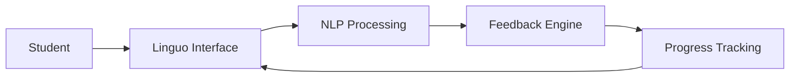

# Linguo

Linguo is a local-first conversational tutor prototype for SRM University's 21CSE552T Computational Linguistics course. Its learning loop is **Teach → Demonstrate → Practice → Evaluate**, with source-linked lecture material and persistent learner progress.

## Run locally

Requires Python 3.11 or later.

```bash
make setup
make scrape
make build-data
make run
```

Open `http://127.0.0.1:8000` and choose a display name. The initial setup downloads Python packages, Playwright Chromium, NLTK data, and (where supported) spaCy's `en_core_web_sm`. The core tutor runs locally. The optional AI Practice Lab uses Groq when configured and falls back to local/source-based practice if AI is unavailable.

The interface in `frontend/` is static HTML, CSS, and JavaScript served by FastAPI; no `npm install` or separate frontend server is needed.

### Optional Groq Practice Lab

Copy `.env.example` to `.env` and set `GROQ_API_KEY` there. Keep `.env` private; it is ignored by Git. The server selects configured models only when they appear in Groq's `/models` response, otherwise it picks available chat models. `AI_ENABLED=false` disables the integration. `AI_DAILY_BUDGET` and `AI_USER_RATE_PER_MINUTE` set the per-learner caps. AI calls are grounded in retrieved lecture passages; usage records contain feature, model, token counts, latency, prompt version and optional thumbs feedback, not the prompt or response text. The teacher audit endpoint exposes that metadata only after the learner opts in.

In Practice Lab, NLP Sandbox combines local tokenizer/POS/NER/stemming/CFG/similarity outputs with an optional grounded explanation. Micro-lessons and teach-back target retrieved course passages. Error Hunt requires the optional spaCy English model. Ask Linguo streams the response and displays the lecture citations. When Groq is down, the app displays offline status and keeps local/source-based activities available.

On Windows without GNU Make, run the equivalent commands:

```powershell
python -m pip install -r requirements.txt
python -m playwright install chromium
python scripts/download_models.py
python scraper/scrape.py
python scripts/build_questions.py
python scripts/validate_data.py
python scripts/seed_demo.py
python -m uvicorn backend.app.main:app --reload
```

To smoke-test the browser flow after starting the server, run `python scripts/smoke_playwright.py`. Automated logic/NLP/retrieval tests run with `python -m pytest`.

## Architecture



FastAPI serves the responsive interface and local JSON APIs. SQLAlchemy stores players, attempts, XP events, stars, badges, question ratings, boss runs, and review schedules in SQLite. Scikit-learn TF-IDF retrieval searches the scraped lecture text; the tutor returns a passage and its source link instead of guessing when retrieval has no match. NLP demonstrations use NLTK, scikit-learn and an optional spaCy English model.

## Course material and attribution

Source: [21CSE552T Computational Linguistics](https://lectures.rebeccakennet.com/21cse552t-computational-linguistics/), Rebecca Kennet, SRM University, School of Computing. The primary text listed by the course is Bolshakov & Gelbukh, *Computational Linguistics: Models, Resources, Applications* (IPN, 2004).

The scraper checks and caches `robots.txt`, uses a descriptive User-Agent, waits about one second between uncached page requests, caches HTML in `data/raw/`, and uses Playwright only to discover links hidden in unit accordions. Scraped content is for this personal academic prototype; do not publish or redistribute it. Attribution appears in the app. `data/scrape_report.json` records the crawl result.

## Data and progress

`data/lectures.json` is the lesson source of truth. The question builder uses terms that occur in those lecture pages and stores a source lecture URL for every auto-graded item; validation checks lecture counts, per-unit question minimums, citations, and answer presence in the source text. The current bank includes 380 term-recognition questions (ten per lecture) and 430 verbatim exam-prep prompts. The exam-prep page supplies questions without an answer key, so Linguo displays those as ungraded discussion prompts instead of making up answers. The SQLite database is created at `data/linguo.sqlite3`; set `LINGUO_DB` to use another local path.

The prototype includes five map regions and 38 lecture levels, ordered level unlocks, 1–3 star clears, a timed three-life boss, deterministic daily question, XP/ranks/streaks, 22 badge definitions, dashboard, local leaderboards, teacher demo summary, and Leitner-style due dates. XP for speed bonuses is capped per day, repeated-question rewards decay, and level replays stop earning XP after three plays per day. Topic ratings use an Elo update and select questions near an estimated 75% success probability.

## Gamification

XP rewards effort for wrong answers, rewards correct first tries more, and gives small capped speed bonuses. Stars mark performance bands; streaks and daily goals encourage short return visits. Bosses provide a mixed unit review with a timer and lives, while ordinary learning has no heart penalty. Level replays remain available to improve stars.

| Action | XP |
|---|---:|
| Correct on first try | 10 |
| Correct after a hint | 5 |
| Incorrect attempt | 1 |
| Fast correct bonus | Up to +5, daily cap 20 |
| Boss clear | +50 |
| Perfect level | 3 stars (no separate XP bonus yet) |

Ranks advance every 200 XP: Token Trainee, Tagger, Stemmer, Parser, Lemma Lord, Grammarian, Chomsky's Apprentice, Meaning Maker.

Badge shelf (locked conditions are shown in the app): First Token, Sharp Tagger, Entity Hunter, Stem Cell, Twin Texts, Tree Climber, Homonym Hunter, Synonym Spotter, Hint-free Hero, Comeback Kid, Night Owl, Early Bird, 7-day Streak, 30-day Streak, Unit Conqueror I–V, Boss Slayer, Perfect Level, Curious Mind.

## Demo conversations

1. “What is HPSG?” → Linguo retrieves a matching lecture passage and cites its lecture URL.
2. “Quiz me on Unit 2” → Linguo points to the Unit 2 lecture levels and their sourced practice bank.
3. “Show NER on: Ada Lovelace visited London on Monday.” → the local model displays recognized entities when installed.
4. “Explain my mistakes” → Linguo identifies weak topics from recent attempts.
5. “What should I do next?” → Linguo recommends the next available map level; due review items are available in the Review API.

## Limitations and future work

- The bank currently generates grounded term-recognition MCQs; fill-in, tagging, free-response grading, richer explanations, and distractor review need instructor validation.
- NLP controls are text-based demonstrations, not the requested drag/drop Token Slicer, POS Sorting Hat, Entity Safari, or the remaining mini-games. They are keyboard and touch usable as forms, but span F1 scoring and a full dependency-tree visualizer are future work.
- Chat retrieval returns source passages rather than composing a full conversational lesson. Commands for quiz, badges, daily challenge, mistakes, and next action are rule-based; hints and structured Teach/Demonstrate phase transitions need expansion.
- Teacher class reporting uses explicitly labeled demo learners. Teacher quest authoring, WebSocket duels, adaptive bot play, class filters, and shareable PNG cards are not included.
- Mastery uses recency-weighted attempt accuracy and SRS due dates; mastery decay, streak-freeze redemption, comeback detection, complete quest/boss analytics, and richer spaced-repetition tuning remain future work.
- The scraper's browser fallback requires Chromium during initial setup. No Playwright or course-site request is needed after raw pages and the discovered-link manifest are cached.

## 2-minute demo script

1. Create a display name and inspect the daily goal, XP, and streak cards.
2. Open the world map and select the first available lecture in Unit 1.
3. Read its source-derived micro-lesson, answer its ten questions, and evaluate for stars and XP.
4. Open Practice Lab and run the Token Slicer, stemming, similarity, or CFG demonstration.
5. Ask Linguo “What is HPSG?”, open the cited lecture, then view the updated dashboard and trophy shelf.
6. Open Teacher View to see seeded class-level demo progress and the hardest items.
